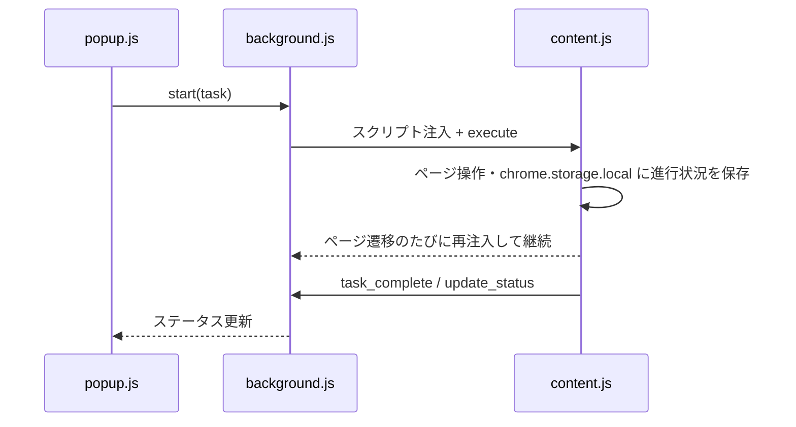

# YAMAP Automation Extension

[YAMAP](https://yamap.com) 上の定型作業を自動化する Chrome 拡張機能(Manifest V3)です。ポップアップのボタンから実行し、ログイン済みのタブ上で画面遷移しながら処理を進めます。

> [!WARNING]
> 非公式の個人ツールです。利用は自己責任で、YAMAP の利用規約を必ず確認してください。詳細は「[注意事項](#注意事項)」を参照してください。

## 特長

| 機能 | 状態 | 内容 |
| --- | --- | --- |
| 1. リアクションのお返しを実行 | 実装済み | 直近7日以内の自分の活動日記に絵文字をくれたユーザーの最新の活動日記へ「👍」を送信(送信済みはスキップ) |
| 2. フォロー中タイムラインを巡回 | 開発中 | 現状はメッセージ表示のみで処理は未実装 |
| 3. 「近くにいた人」をフォロー | 開発中 | 現状はメッセージ表示のみで処理は未実装 |

- ポップアップの **停止** ボタンでいつでも中断可能
- 進捗はポップアップのステータス欄に表示

## 技術スタック

- Chrome Extension Manifest V3(Service Worker / Content Script / Popup)
- JavaScript(ビルド工程なし)
- 権限: `storage`, `tabs`, `scripting`、ホスト権限は `https://yamap.com/*` のみ

## 動作要件

- Google Chrome(Manifest V3 対応版)
- YAMAP にログイン済みであること

## セットアップ

1. このリポジトリをクローンまたはダウンロードします。
2. Chrome で `chrome://extensions` を開き、右上の「デベロッパー モード」を有効にします。
3. 「パッケージ化されていない拡張機能を読み込む」でこのフォルダを選択します。

## 使い方

1. YAMAP のページ(`https://yamap.com/`)をログイン済みの状態で開きます。YAMAP 以外のタブでは実行できません。
2. 拡張機能のアイコンからポップアップを開き、実行したい機能のボタンを押します。
3. 自動でページ遷移しながら処理が進みます。完了するとステータス欄に結果が表示されます。



## 構成

```
.
├── manifest.json    # 拡張機能の定義
├── popup.html / popup.js   # UI(ボタン・ステータス表示)
├── background.js    # タスク管理、content.js の注入、停止処理
├── content.js       # YAMAP ページ上での実処理
└── images/          # アイコン
```

## 制限事項

- 機能2・3は未実装です。
- YAMAP のページ構造に依存したセレクタを使っているため、サイト更新で動かなくなる可能性があります。
- 実行中の進行状態は `chrome.storage.local` に保存され、タスク開始時と完了時にクリアされます。

## 注意事項

- 本拡張機能は YAMAP の公式ツールではありません。自動操作は **YAMAP の利用規約に抵触する可能性** があります。最新の規約を確認し、**自己責任** で使用してください。
- 本ツールの使用により生じたいかなる損害(アカウント制限・停止を含む)についても、作者は責任を負いません。
- **過度な頻度での実行は避けて** ください。
